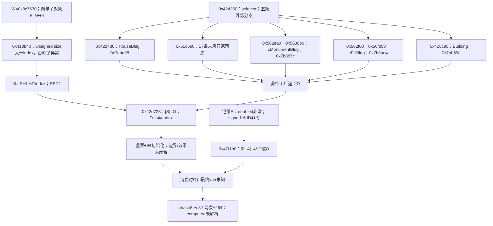
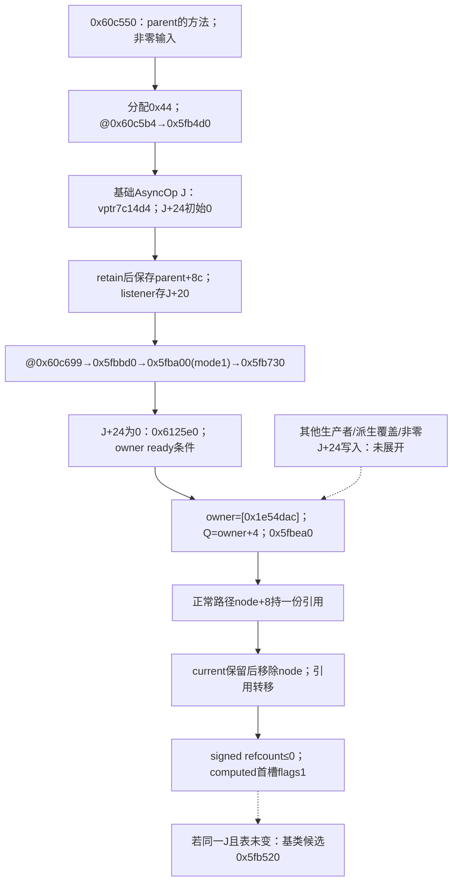

# phase8 对象与 worker 释放的静态 ABI 合同

2026-10-11，基线 `59276a1158ad72bf37838ea92425307acd881313`。本轮补清 phase8 的索引来源，并找到 worker 的 `WONAPI::AsyncOp` 基类虚表候选及删除析构包装器。**消费时phase8对象的最终虚表和worker当前对象仍未绑定；最后一批已补四项构造时表候选及一条基础AsyncOp条件生产路径，完整原tick没有通过证据。** 主路线和历史边界见 [REA_BINARY_ROUTE](REA_BINARY_ROUTE.md)。

固定输入 SHA256 为 `8a6d2df1015cb75d797546d117da5f82b86fd08726090c2a13d853b9009d6753`，i386 PE32，地址以下均为该映像 VA。合同中的指针、栈槽和整数均按原 32 位布局记录，不能直接转成宿主 64 位地址。字段用途以读取/写入事实表述，未恢复的业务含义保持未知。

后续构造/注册结果及最后一批对象来源图、未展开表见文末与allowlist候选清单；下表已按新增证据更新。具体实例最终虚表仍未知，各轮范围/时间分别记录。

## phase8：对象来源与三个虚调用

令 C=`0x10bc910`，P=`0x8c7634`，R 为记录指针，O 为池中对象指针。已保存的 `0x4aeeb0` 与本轮小视图共同确定：

| 来源步骤 | 静态合同 | 尚缺的条件 |
|---|---|---|
| `0x506240 → C`；`0x413a50(1)` | 后者是带边界检查的索引访问，向量子对象为 C+4。begin=`[C+8]`，end=`[C+0xc]`，元素宽 4 字节；检查元素数>1，返回 begin+4。`0x413a80` 是 `invalid_vector<T>_subscript` 的抛异常路径，并非扩容 | 索引 0 被跳过的原因、初始化后的容量/记录有效性、异常处理合同未知；此前“begin helper”的称呼不足以表达这项检查 |
| 槽解引用 → R；R+8 → ID | 每个槽取 32 位 R；R+0xc 字节非零，再把 R+8 的有符号 16 位 ID 符号扩展到 32 位，排除零 | 此处未证明 ID 非负或位于池范围内，不能补猜范围检查 |
| `0x47f1b0`，ECX=P，栈参数 ID | `0x4f8210` 取 `[P+4]`；返回 slot=`[P+4]+4*ID`，`RET 4`，随后 O=`[slot]` | 最后一批已核对W=0x8c7630、P=W+4及0x413b40同槽公式；R-ID赋值/启用、begin分配与对象生命周期及登记后的最终vptr仍未闭合 |
| C 的构造来源 | `0x506130 → 0x506250` 写 `[C]=0x7b430c`，再调用 `0x506350(0)`；后者清理/重置并条件调用 `0x506380(200)` | C 的包装对象表不是 O 的表。后续0x506380分配0x110并以0x5068d0构造R，表为0x7b431c、reset将ID/启用归零；有效ID/启用的后续写入未闭合，C或R的表不能解析O |

`0x408b00`、`0x408b40` 和 `0x406ebe` 处选定池引用均为查找消费者，没有找到当时的池写入链；后续通过包装对象W定位登记槽写入，见文末。`0x406ebe` 有解码直接 CALL→`0x47f1b0`，但提供者未给出所属函数；不从邻近地址强建函数。映像初始池/容器字节为零只描述导入映像，不能证明运行时为空。对 `[P+4]`/`[C+8]` 的直接 xref 查询为空，也不能排除通过 ECX 等别名写入。

| 站点与表槽 | 对象/实参来源和调用约定 | 返回与所有权 | 已证与未知 |
|---|---|---|---|
| `0x4aef47`，`[O] + 0xc8`，零基第50槽 | ECX=O；一个 32 位栈槽，值 `0x35`。调用点之后未见相应 caller pop；与 x86 thiscall 的 callee 清栈相容 | caller 只测试 AL 的 8 位真值；此处无显式 retain/release | computed/unresolved；具体表、callee、`RET 4`、异常/副作用及对象存活期未知。不能从 AL 使用推断整个 EAX 返回类型 |
| `0x4aef92`，`[O] + 0x264`，零基第153槽 | ECX=O；一个 32 位类别栈参数，来自 `0x5db530` 的递增筛选（1..9） | EAX 的 32 位位型参与局部和；无显式 retain/release | computed/unresolved；返回的签名/单位、具体 callee 及清栈仍未知 |
| `0x4aefaa`，同一 `+0x264` 槽 | ECX=同一个 O；两次汇编均从同一 caller 栈槽加载类别。需先满足记录类别字节不等于2 | EAX 的 32 位位型加到类别累积槽；caller 没有缓存第一次结果 | callee 清栈/副作用未闭合，未证明运行时两次参数值相等。不能合并调用；伪代码 `unaff_EBP` 不构成额外参数证据 |

共同前置还包括 O+4 字节筛选为1或3、O+0x48 非零及 O+0x24 的有符号 short>0。这些条件支持当前遍历合同，不证明城市业务名称。实现接线应保存两次调用顺序、参数宽度和返回使用，未知表/目标保持明确缺项；不得按偏移给出成功 stub。

## worker：队列、payload 与基类候选要分别绑定

令 Q 为 `0x5fbfc0` 的 incoming ECX，J 为 AsyncOp 布局候选 payload。Q 的表与 J 的表不同：

| 对象 | 写入/布局来源 | ABI 与生命周期的已证部分 | 未知 |
|---|---|---|---|
| Q，队列上下文 | `0x5fbc30` 写 `[Q]=0x7c14e4`；Q+4 为 critical section，Q+0x1c 写嵌入事件表 `0x7c14ec`，Q+0x20 保存 CreateEvent(NULL,FALSE,FALSE,NULL) 结果，Q+0x28 为12字节链表哨兵，+0x2c 计数，+0x30 当前对象，+0x34 字节归零 | `0x5fbd30` 排空、释放当前引用、移除节点/哨兵、CloseHandle、DeleteCriticalSection；`0x5fbce0` 是嵌入事件的删除包装器 | Q 表首槽指向 `0x5fbd10`，本轮未展开；事件创建/等待是否成功未知。不能将 Q 或嵌入事件的表拿去填 worker payload 首槽 |
| J，基类构造候选 | `0x5fb4d0` 先写基表 `0x7aca84`、J+4=0、初始化 J+8 的锁，再在 `0x5fb4ec` 写 `[J]=0x7c14d4`；J+0x20=0、+0x24=0、+0x28=0、+0x2c=-1、+0x30=1、+0x34=100004、+0x38..0x3a=0、+0x3c=0 | ECX=J，无显式栈参数，EAX=J，`RET`；伪代码 void 签名没有表达该寄存器返回。RTTI locator `0x7d7a88`→type descriptor `0x85ca08`，名字 `.?AVAsyncOp@WONAPI@@` | 最后一批找到0x60c550方法分配基础J并条件提交；其他构造调用者可能覆盖首word，当前节点J的实际来源/派生类型仍未绑定 |
| 候选表 `0x7c14d4` | 三个选定表项为 `+0 → 0x5fb520`，`+4/+8 → 0x4e1c20`；构造及析构均有首word写入证据 | 构造写入另以独立指令解码核对；首项包装器已展开 | 只证明该基类表和包装器确实存在。不能把它登记成所有派生 J 的唯一表；`0x4e1c20` 未展开，不认定其为空操作 |

队列接线的筛选合同如下：

| 函数/站点 | 来源、参数与返回合同 | 所有权与仍未知部分 |
|---|---|---|
| `0x5fba00 → 0x5fb730` | J 是 incoming ECX；提交写状态100000、时间及两个32位字段。`0x5fb730` 取 Q=`[J+0x24]`，非零时把 J 作为一个32位栈参数调用 `0x5fbea0`；否则交 `0x6125e0` | 证明有条件的payload→指定队列路径；后续已定位global owner+4 fallback及一条J+0x24初始零的基础生产者。非零J+0x24写入、其他工厂/实际current仍未知 |
| `0x5fbea0`，enqueue | ECX=Q，一个32位 J 参数，`RET 4`；锁 Q+4，检查当前对象/状态，链接节点，payload 位于 node+8，计数变1时 SetEvent(Q+0x20)；caller 不使用返回值 | 先对 J+4 做一次临时 retain，调用 `0x718850(node+8,&holder)`，再释放临时引用。本批已展开该helper：非空payload+4 increment后写node+8，正常入队支路净保留一份节点引用；异常/失败及外部引用仍未知 |
| `0x6eb1c0 → [Q+0x30]` | ECX=&current，栈参数为节点 payload；相同指针不替换，否则旧对象先 decrement/release，再给新对象 increment并写入，EAX=新指针，`RET 4` | 随后 `0x6054e0` 移除节点。本批已将节点删除接到holder析构尾跳及payload decrement/首槽释放；实际派生首槽与异常展开仍未知 |
| `0x5fc139`，payload 首槽 | J=`[Q+0x30]`；InterlockedDecrement(J+4)的**有符号结果≤0**才调用 `[J]` 首项，ECX=J，一个32位参数1，返回值未使用，随后 current=0 | 静态站点依旧 computed/unresolved。候选类型/释放布局相符，实际 J 的 vptr 未唯一绑定；不能将条件改写为“恰好等于0” |
| `0x5fb520`，基类删除包装器 | ECX=J，一个32位 flags 栈槽，只测试低字节 bit0；先 `0x5fb540`，bit0为1时将 J 作为32位栈参数传 `0x77bb31`，caller清4字节；EAX=原 J 位型，`RET 4` | 该**候选 callee 的 thiscall/清栈/flags/返回**已由汇编核清；`0x5fb530→0x77bb31`另有 typed direct CALL。本批补出forwarder→0x7656df及其条件HeapFree分支；模式2/3、实际heap/allocator身份及释放结果仍未知；返回位型不代表对象仍可访问 |
| `0x5fb540`，基类析构体 | ECX=J，无显式栈参数，`RET`；重写基类表，释放 J+0x20 listener 的引用/首槽，删除 J+8 的锁，再写 `0x7aca84`；使用 x86 FS 异常链 | listener 的动态类型和目标仍未知，SEH/异常展开合同不能省略。原程序运行及锁/析构成功均未验证 |
| `0x5fb8a0@0x5fb92b`、`0x5fb9c0@0x5fb9c5` | J 的虚表 `+8`、`+4`；ECX=J，无显式栈参数，返回值不用于已观察路径 | 方法语义/派生目标未知。listener 虚表 `+4@0x5fb97b` 另接一个4字节引用 holder，其按值 ABI 和持有转移未闭合，不当作城市 tick callback |

外层 `0x6124a0@0x6124f4` 到队列处理的直接调用和 `0x5fbfc0` 的 `RET 8` 属前轮证据，本轮按第二方核验补全参数条件：ECX为外层+4，**第一参数在外层 byte +0xa1=0 时为0，非零时为 ESI 中的输入时间预算减已经过时间**；第二参数来自 EBP。外层+0x9c 的虚槽+0x24 调用只在 +0xa1=0 分支发生。该路径与原城市主调度、线程注册/入口的连接依旧未知。AsyncOp RTTI 支持基类身份，不能单凭类名推出线程角色或恢复城市逻辑。

## 最小收敛条件与下一步三个任务

| 工程任务 | 最小材料与具体通过标准 |
|---|---|
| 1. 闭合 phase8 对象虚表来源 | 最后一批补清0x413b40及0x42d360四项构造表候选；仍需闭合secondary17条返回边、R-ID写入/启用、登记+0x94后的最终表及完整表范围。通过标准为同一来源→有效槽归属/函数入口→参数/AL/EAX/清栈一致；仅有构造候选或偏移字读数不通过，不能把相邻表的字错认方法槽 |
| 2. 闭合 worker 实际类型与引用转移 | 从 J+0x24 写入、工厂/最终构造写入到 `0x5fbea0` 的 node+8，使用本批已核对的0x718850 retain及节点holder release局部链，继续核对排空/current/末次release的实际对象与异常合同，绑定实际首槽以及allocator模式2/3与heap归属；引用增减、参数1、`RET 4`、allocator与SEH合同一致。基类候选 `0x7c14d4→0x5fb520` 可作定位线索，不可直接注册为实物目标 |
| 3. 建立可拒绝未知项的声明式 ABI 清单 | 只记录已证明的32位布局、call-site、候选集、来源Evidence与未知条件，使用完全自造描述项检查缺表/越界/未知目标/未闭合所有权时明确拒绝；不导出原指令或可执行游戏库。通过标准是“静态候选”和“已绑定目标”不能混填，phase8两次调用顺序、flags低位/栈宽、pointer宽及signed refcount条件逐项可审计。该独立清单验收也不等于完整tick通过 |

上述是ABI初批提出的收敛目标，已按后续两批局部事实更新；最终来源图、未展开边及各批停止条件见文末。若以后有另行授权且允许的运行观察，还需要同一对象实例在消费时的 vptr、节点/current引用转移与栈平衡材料；当前没有这些运行材料，也不采用旧被拦截的转换执行或城市动态对照路线取得它们。

phase8只覆盖 `0x4ac2b0` 的 case8。主调度步序范围0..50，归零还进入慢周期；消息/窗口活动、模式、时钟/暂停、初始化对象与表、其他50个case、平台API、异常/heap/线程及连续退出/恢复都影响自然 tick。单个case的静态连接、候选析构器或对象统计输出不能证明自然执行了一整圈，更不能证明原城市状态、有序写入、事件和连续恢复等价。

## 本地凭据与复现边界

本轮使用同一固定 REA6.4.0/Ghidra12.1.2 和 profile digest `e3402f2d7c487875edf3c6215fa95d67ee1fa133ba68c2390a9338b38656a7b2`。一个官方临时只读会话完成查询后正常 close；默认自动分析仍会覆盖映像，人工查询仅选本问题相关地址。没有执行目标/派生游戏库、读 GameData 或沿用旧游戏 Swift，没有新安装/下载、UI或设备操作，也未改权限/官方 ownership guard。

| 实际检查 | 结果 |
|---|---|
| 查询范围 | 新增20个唯一函数，100项有界小视图操作；单项≤8MiB、累计约1.42MB，选定数据读取总220字节；没有扩出无界图 |
| 关键站点 | 独立查询6个call-site：`0x4aef47/0x4aef92/0x4aefaa/0x5fc139/0x406ebe/0x5fb530`。另3个指令锚点 `0x406eb8/0x406ebd/0x5fb4ec`；合计9个地址低于10上限，不能称9个调用点。表内其他站点由函数汇编读出 |
| 时间与清理 | UTC 11:03:21.645539→11:16:43.668592，802.024秒，exit0；1200秒整体上限、1170秒取消点、原 close清理；自有临时根结束为空，不推断全系统残留为零 |
| 输入与工具指纹 | 输入SHA/设备/inode/mtime前后一致；18份选定官方 ownership/config/session 模块有实际成对前后SHA，逐项相等。范围不是所有安装文件，未提供独立cache-hit验证；本会话close删除项目，不声称跨进程缓存复用 |
| 可靠性 | 继承主路线的反编译警告及 computed目标限制；基类ctor/删除包装器返回与参数采用汇编，避免伪代码void/byte签名失真。Evidence绑定subject/profile、保存内容SHA核对仅说明可追溯，不能认证所有语义 |

原始Evidence、汇编/伪代码、自有日志和控制脚本仅在 `/Users/zoomzhao/Documents/Codex/2026-10-08/task-2/rea-static-abi-20261011/` 留存；`verified-abi.json` 记录筛选合同、Evidence ID、文件SHA和范围验证，`session-result.json`/`session-status.json` 记录完成/输入/清理/成对工具指纹。Git只发布本筛选附录和主文档链接/更正，不发布二进制、原始分析、工具或资源。历史及本轮无执行事实保持分别记录。

## 构造/注册链收敛：已找到写入者，实例目标仍未知

2026-10-11，基线 `8aac970ff6d4160a1633b521c935c0db8b71590e`。同一固定 PE/profile 的新一批静态证据补清节点引用复制/释放及 owner 构造注册，并找到与池包装对象关联的登记槽写入。**没有得到 phase8 的最终虚表或 worker 当前 payload 的实际派生类型。** [allowlist候选清单](rea-abi-allowlist-candidates.json) 是筛选后的声明式研究记录：直接调用/具体写入与动态候选分别标记，每项有 Evidence ID/内容SHA、适用范围和未知拒绝条件，所有执行/运行绑定标记保持关闭；没有成功 stub 或游戏指令转换。

| 新证据 | 可确定的局部合同 | 不可据此确定的部分 |
|---|---|---|
| 包装对象 W=`0x8c7630` → `0x420ef0@0x420f0b → 0x42d540` | 调用传 ECX=W、五个32位栈参数（caller字段+8及四个0）；登记函数两条返回路径均 `RET 0x14`，正常返回所选索引，失败返回0。它的向量end查询使用 W+4=`0x8c7634`，与前述 P 地址一致 | 最后一批已直接展开0x413b40：向量=W+4，unsigned size>index检查，返回[P+4]+4*index；来源基于自身证据，不靠类似0x413a50的猜测 |
| `0x42d6fb → 0x413b40` 得 S；`0x42d714 → 0x42d360` 得 O；`0x42d723` 写 `[S]=O` | 登记槽写入另有独立 MOV 解码；写入前对旧对象虚表+4调用flags1，随后写 O+0xb4=索引，并调用新 O 的虚表+0x94。工厂返回值→保存寄存器→槽写入的局部来源闭合 | 最后一批已补同索引槽公式及工厂四条构造表候选；secondary17条返回边、R-ID写入、登记后虚方法/最终vptr与表范围仍缺，+0xc8/+0x264目标不得登记为已闭合 |
| 记录 R 的分配→`0x5068d0`→`0x506920` | `0x506380` 分配0x110字节后构造 R，构造写 `[R]=0x7b431c`；reset将 ID short+8及 enabled byte+0xc 等字段归零 | R、包装对象C和池对象O是不同来源；R的表不能代替 O 的表，构造初值不证明运行时永远为空/禁用。设置有效ID/启用的后续写入仍缺 |
| 队列复制 `0x5fbf47 → 0x718850` | 两个32位栈参数，caller清8字节；非空payload时对+4原子increment再写 node+8。正常完成的入队支路中：临时retain +1、节点copy +1、临时release -1，净留一份节点引用 | 拒绝入队支路不复制；异常/分配失败、外部同时持有/回调再入未验证，不能把局部账目当全任务终止或运行通过 |
| `0x6054fd → 0x58d6c0`，随后两条尾跳到 `0x58f2c0/0x4799b0` | ECX从 node+8 holder 转成 J；对J+4 decrement，signed≤0时ECX=J、32位flags1调用首槽。配合先前current替换的retain，正常出队后节点引用被释放而current保留一份，current末次release条件已见 | 首槽仍computed；这些JMP不当普通CALL/额外栈帧。回调的额外retain/requeue、listener类型、异常展开和实例目标/清栈仍未知 |
| `0x77bb35 → 0x7656df`；`0x7657b3`解析到 HeapFree | 释放forwarder是cdecl-compatible，接一个32位指针；下层按 `[0x1e58d24]` 模式选择，通用分支取 `[0x1e58d20]` heap、flags0调用HeapFree。该导入站点是resolved-indirect/computed | 模式2/3有未展开辅助路径，部分分支不会再到HeapFree；实际heap初始化/allocator归属、失败和成功释放没有运行证明，不能升级为“所有对象直接HeapFree” |
| `0x612040@0x612063 → 0x5fbc30`；`0x611f60@0x612007`写全局owner | constructor给ECX=owner+4构造Q，写owner表 `0x7c1808`再注册到 `0x1e54dac`；RTTI locator `0x7d8690`→descriptor `0x8775a8`→`WONAPI::WONAPICore`。fallback `0x6125e0` 从该global取 owner+4 后调用enqueue；析构 `0x6120f0` 清global并析构Q | owner constructor自身 `RET 4`，该栈参数意义未恢复。WONAPICore owner、Q、AsyncOp payload不可混用；此链不证明J+0x24的具体注册写入、实际派生构造、工作线程注册或城市主调度连接 |

本批也保存明确的负面/限制结果：P的end/capacity地址直接xref为空；首尾选定P引用未获所属函数或仍为查询消费者；`0x4f19a0`是虚方法遍历消费者，不能当构造者。相邻包装地址W的xref使登记路径可定位，但不等于全部写入者已找到。AsyncOp邻近选定方法只写listener/模式/预算/字节字段，未找到J+0x24注册；未遍历全部派生类来凑唯一结论。

## 本轮停止条件及最小后续材料

该构造/注册批达到25个新增函数及10个关键地址上限后停止，留下0x413b40、0x42d360、J+0x24写入/派生构造及allocator模式2/3前沿。最后一批随后补清前两项的选定分支和一条基础AsyncOp生产路径，精确剩余边见最终未知表。**各批没有宣称静态已穷尽，也没有认定只有运行时才能继续。** 没有因预算边界转去运行目标或编造完整接线。

| 若静态前沿仍不能唯一绑定，最小观察材料 | 对应通过标准 |
|---|---|
| 同一自然phase8输入的ID、slot、O；登记写入及+0x94方法之后、每个虚调用之前的最终vptr和槽目标；对象存活区间 | 生产和消费使用同一实例/槽，callee参数与栈平衡/返回使用相符，晚写/替换与派生覆盖可追溯；观察到一例只证明该实例，不能泛化全部类 |
| 同一J从enqueue node+8到current再到release的最终vptr；每步signed refcount、owner/队列、回调retain/requeue、实际首槽及flags/栈清理 | 节点/current引用转移和实际callee相符，候选表不能替代实际对象值；不能以基类RTTI或参数1独立宣布析构/free成功 |
| 分配器模式、heap的创建/所属对象、异常展开及真实释放结果 | 与对应allocator路径一致，覆盖模式2/3或显式拒绝这些模式；没有结果时保持未验证 |

以上是缺失的数据要求，不是运行命令或运行授权。本任务没有执行原程序/派生游戏库、启用动态对照/旧转换路线，未新增权限、UI或设备操作。完整51步序自然tick、原状态/有序写/事件及连续恢复仍无通过证据；静态登记、helper引用账目和allowlist草案不替代它们。

该批一个官方临时会话，UTC 11:26:54.381838→11:37:04.276725，runner单调时钟记录609.909秒、exit0，1200秒限额内正常close且自有临时根为空。新增25个函数，另重用2个已查函数的小视图/调用者查询；112项有界操作、单项≤8MiB、累计约1.83MB、选定数据152字节。10个独立地址中7个是call-site、3个是登记/上下文指令锚点；表内其他位置来自函数汇编，未另计独立查询。18份选定官方模块有实际成对指纹相同，输入身份/SHA及已有草稿/选定源码未变；不声称全部安装文件认证或跨进程cache-hit。

第二方对先前固定 `8aac970` 的ABI核验通过15项实质一致性检查，未发现新实质错误；其范围只覆盖上一批，不能当本批独立复核。报告在本地 `2026-10-11/task/city-validation/rea-abi-8aac970-review/REVIEW.zh-CN.md`。本批 `verified-bindings.json` 核对所有保存Evidence、关键typed call/写入及RTTI链，保存范围/负面结果；原始伪代码/汇编/日志/控制文件仅在 `/Users/zoomzhao/Documents/Codex/2026-10-08/task-2/rea-static-binding-20261011/` 留存。Git只发布本筛选增补、主文档链接和候选清单，不上传原始分析、二进制、工具或GameData。

## 最终对象来源图与未展开前沿

2026-10-11，基线 `d2e7d29f4f00cf1b112e267df81fa012af13af04`。最后一个限定批次补清 `0x413b40` 的索引槽关系，得到 `0x42d360` 四条构造分支的首word写入和RTTI身份，并找到一条生产基础AsyncOp再提交的条件路径。**四项是构造时表地址候选，尚未证明表范围、登记后首word或当前phase8实例；worker当前J也未绑定。** schema2 [候选清单](rea-abi-allowlist-candidates.json) 保存来源和拒绝条件，所有执行/运行绑定继续关闭。

### phase8：登记槽与构造来源

`0x413b40` 明确以 W+4=P 查询长度，使用无符号 size>index 检查，失败调用 `0x413b70` 抛 `invalid_vector<T>_subscript`，正常取 `[P+4]+4*index` 并 `RET 4`。这补清登记helper和 `0x47f1b0` 对同一可表示索引的槽公式；**登记索引是32位，消费ID仍是有符号16位扩展**，R-ID写入/启用、池backing分配/替换与对象存活期没有因此闭合。

下表条件按工厂检查先后记录，条件值均为AL；四个外层谓词体未展开，不能从selector或类名恢复业务规则。分配失败返回0；`0x562f00` 的selector不是0x5e时也返回0。工厂 `RET 4`。

| 工厂分支条件 | 分配字节 / 构造入口 | 构造末段写入的vptr | RTTI身份及来源 |
|---|---|---|---|
| `0x5188b0(selector)≠0` | 0x10c / `0x42d480` | `0x42d4b9 → 0x7aba38` | `.?AVHouseBldg@@`；写入汇编、独立解码、表前缀→locator→descriptor |
| 首谓词=0，`0x51c620≠0` | `0x51c660`，17条返回边未展开 | 未闭合 | 不把17个返回函数说成已恢复17个类 |
| 前两项=0，`0x562e80≠0` | 0x160 / `0x562ea0 → 0x5630b0` | `0x5630e9 → 0x7b887c` | `.?AVcMonumentBldg@@`；同上 |
| 前三项=0，`0x562e90≠0`，selector=0x5e | 0x160 / `0x562f00 → 0x56fb50` | `0x56fb89 → 0x7b8ad4` | `.?AVcFillBldg@@`；同上 |
| 四项均=0 | 0xc8 / `0x426c90` | `0x426cbc → 0x7ab59c` | `.?AVBuilding@@`；写入汇编、独立解码、RTTI链 |

三个派生构造 `0x42d480/0x5630b0/0x56fb50` 先调用 `0x426c90`，分别调用 O+0xc8 的 `0x517190/0x561d60` 子对象构造，再写根vptr并返回原指针。这些子构造未展开。基构造之后的 `0x426e60` 清零从O+4开始的45个32位字，设置O+0xb4=-1并调用GUID相关导入，没有显式覆盖首word；这只证明选定构造路径的根表来源。登记随后执行虚表+0x94，仍可能改变对象/表；构造类别不证明O+4、O+0x48、O+0x24等phase8门槛成立。

**表范围是当前实质缺口。** 四个表地址的native data-type结果都只表示4字节pointer，没有完整数组长度。如下是固定地址读到的32位字，不是已验证的方法槽；每项 `vtable_membership_verified=false`、`callee_ABI_verified=false`。

| 构造vptr地址 | 地址+0x94读数 | 地址+0xc8读数 | 地址+0x264读数 |
|---|---|---|---|
| `0x7ab59c` | `0x428aa0` | `0x427180` | `0x42cc30` |
| `0x7aba38` | `0x428aa0` | `0x427180` | `0x42e0b0` |
| `0x7b887c` | `0x428aa0` | `0x427180` | `0x56fc20` |
| `0x7b8ad4` | `0x428aa0` | `0x427180` | `0x570bc0` |

特别是 `0x7b887c+0x264 = 0x7b8ad4+0xc`，字读数落入另一个构造表的近端区域；不能依据邻接把它认作前一类第153方法槽。`0x428aa0` 的伪代码/汇编/引用三次函数查询均返回“没有procedure”，已保留失败；containing-procedure为not_in_procedure，但单指令解码得到 `MOV EAX,[ESP+4]`。因此它有可解码字节，函数边界、完整体和清栈仍未知，不能称代码不存在，也没有通过强建函数或扩预算把它补成已解析callee。phase8目标列表继续为空。

### worker：基础对象的条件生产者

`0x60c550` 是**生产者方法，不是派生构造函数**；原始输出文件中的traced-derived-constructor仅是查询前的本地标签。它在非零输入和正常分配分支中分配0x44，直接调用基础 `0x5fb4d0`，保留并存到parent+0x8c，构造listener并存J+0x20，再调用RunAsync包装器 `0x5fbbd0`。本方法没有显式派生vptr覆盖，基构造初始J+0x24=0，选定提交链未写该字段，故在相关helper未改变它的条件下走全局WONAPICore后备队列。正常提交把status设为100000，后备函数对这个状态要求owner-ready分支；不能说无条件入队。

parent清理 `0x60c6d0`、listener构造 `0x610fb0` 及callback `0x60c780` 未展开，不能忽略其效果。新的 `0x5fb750/0x5fb7f0/0x612620/0x612650/0x5fbb10/0x5fbbd0/0x5fbbe0` 选定方法分别处理完成、超时或run包装，均没有显式J+0x24注册写入；`0x5fbbd0` 不能因旧输出标签pump-register被写成setter。它的caller元数据列36个来源函数，sync包装器 `0x5fbbe0` 列8个，除选定的0x60c550等既有视图外未逐一展开；两组可能相交，不能相加为44种类型。本批只定位一条基础对象候选来源，没有证明所有队列payload都是基础AsyncOp，也没识别 `0x5fc139` 当次current实际来自哪个生产者。

### 未展开项与实际实例值要求

| 缺口 | 现有结论的边界 / 精确剩余边 |
|---|---|
| 工厂条件及secondary返回来源 | 外谓词 `0x5188b0/0x51c620/0x562e80/0x562e90` 未展开；`0x51c660` 17条typed直接返回边：`0x4c0660/0x4c2960/0x5075a0/0x5aae70/0x51bef0/0x4143b0/0x48a800/0x5b3b10/0x5d3580/0x5f0e20/0x50a2f0/0x51c9a0/0x5da3d0/0x4c5dc0/0x51e5e0/0x540770/0x4f8e30`。这些只是函数边，不是业务或类枚举 |
| 根表/虚调用 | `0x428aa0` 的边界/体、登记+0x94的效果、四表范围/槽归属及+0xc8/+0x264 callee ABI仍缺；子构造 `0x517190/0x561d60` 亦未展开。固定偏移字读数不能登记为已绑定目标 |
| 记录与池 | R-ID赋值/enable写入、signed16和登记32位索引的适用关系、P backing分配/替换与O生命周期仍缺；同槽公式不代表同一运行实例 |
| worker类型全集/指定队列 | `0x60c6d0/0x610fb0/0x60c780`、其他run caller、派生覆盖及非零J+0x24写入尚未展开。工厂/方法元数据查询不是这些方法体的验收 |
| 释放及环境 | 既有allocator模式2/3辅助分支、heap归属、listener/异常/回调再入与线程入口连接仍缺；正常引用账目不证明真实free/线程运行 |
| 实际实例值 | 若后来需要实例绑定，最小材料是同一ID/index→slot→O在登记后/消费时的vptr、实际selector分支和对象存活期；同一J的node/current来源、消费时vptr、signed refcount、flags/栈平衡和heap归属。当前未采集，也不以候选值代填 |

本批在20个新函数地址请求、10个关键地址上限处停止。**仍有明确未展开静态边，预算用完不能叫静态不可能或必须运行才能推进。** 实例值需求只用于分清“候选来源”与“当次绑定”；不是恢复旧转换/执行/城市动态对照路线的授权。本批不再继续扩函数，也没有创建运行绑定。

独立于原游戏代码仍最有用的三个工程任务是：

| 独立任务 | 具体通过标准 |
|---|---|
| 自造图片的graphics边界验收 | 555/565及alpha按明确参考式逐像素相符；padding不读写越界，裁剪含负坐标/空区域，缩放按已声明采样规则；旧句柄/迟到完成被拒绝，资源计数恢复基线。GPU读回仅作像素证据，不算完整游戏通过 |
| 自造PCM/事件的audio状态验收 | 精确核对入队样本、游标、有限/无限/0循环语义；不支持格式和失效设备不消费；fake重建后按声明位置续接，完成/取消事件恰好一次。离线结果不称听觉或物理设备恢复通过 |
| 自造MOV的video消费者验收 | 先解决已记录writer-start失败；自造帧/PTS验证seek、epoch旧帧丢弃、取消、EOF恰好一次和资源上限，时序按已声明规则。只证明该原生消费者，不扩大为原Bink/Miles素材或原游戏播放通过 |

上述是可以另行推进的工程验收，本批仅审计和文档发布，没有运行这些测试/二进制或操作UI、键盘、音频设备。

### 最后一批的凭据和范围

一个官方会话，UTC 11:47:59.787175→12:00:58.186752，单调时钟778.4秒、exit0；1200秒整体上限/1170秒取消点，正常close后自有临时根为空。20个新函数地址请求中19个取得函数视图，`0x428aa0` 未被识别为procedure；91项操作包含88份成功Evidence及3份已保存的invalid-procedure错误，不能写成91项全通过。10个独立地址是4个call-site、6个非call写入/上下文指令锚点；选定数据读取2880字节，累计保存1,743,860字节、单项≤8MiB。表内其他站点来自已保存函数视图，不另计独立查询。

输入SHA/设备/inode/mtime前后一致，18份选定官方ownership/config/session模块有实际成对相同SHA；未修改官方guard，未提供全部安装文件认证或跨进程cache-hit证明。`verified-sources.json` 核对Evidence ID/subject/profile/内容SHA、构造写入/RTTI、索引关系、直接调用与失败记录；它是自有一致性核对，不是独立语义认证。保留原有decompiler警告，候选/未知以本节限制为准。

本地目录 `/Users/zoomzhao/Documents/Codex/2026-10-08/task-2/rea-static-final-source-20261011/` 保存原始Evidence/错误/日志、控制与复核脚本、范围/输入/清理结果及发布凭据。Git只发布筛选后的本文、主文档及声明式候选清单，不发布原始反汇编/伪代码、原PE/工具/资源。未执行目标或派生游戏库，没有恢复旧二进制转换/城市动态对照，没有读GameData/旧游戏Swift或新增下载/权限/UI/设备操作；完整51步序自然tick及原状态/有序写/事件/连续恢复没有通过证据。

## 初始化入口与selector筛选继续收敛

2026-10-11，基线 `9056ba7adaa3937322e02c035d075a697be5f6e4`。本批不是原行为运行：同一固定PE/profile的94份静态Evidence补清共同候选函数 `0x427180`：ECX receiver的signed16字段+0x14与一个32位栈参数比较，AL返回相等结果，`RET 4`。phase8参数是0x35，不能把高24位EAX当规范bool返回，也不能从short比较反推完整32位selector值。

登记+0x94的字地址 `0x428aa0` 在数据库中名为LAB，仍没有procedure。独立Listing解码确认入口读首个栈参数、`0x428aaa` 写 `[ESI+0x14]=AX`、`0x428aae` 写byte+4=3，及 `0x428c01 RET 0xc`。这里只闭合入口/写入/返回锚点，完整正常控制流尚未逐指令核清；`0x428b25` 的虚槽+0x90和 `0x428b9a` 的虚槽+0x1e8仍computed。不能以找到RET就宣称全部副作用或最终vptr闭合；下一批继续用只读Listing恢复控制流，不强建函数，不执行字节。

外层选择谓词已展开：primary为2..0x11；fill为0x5e；monument helper以selector-0x4c的unsigned值检查≤0xc0，0x35直接走AL=0路径。结合secondary对0/1及这些类别的排除，**完整32位selector恰为0x35时进入0x51c660**，四个先前构造候选不适用这个工厂入口值。这里不是认定它们永远不能被改字段后消费；short截断别名、后续type/vptr写入和实际实例仍未知。

secondary的前五个选定返回来源已展开；其内部成功构造条件均不含0x35，不能从这些分支得到合法的非空selector35构造。后续第六组filter0x4142e0排除0x35，第七组0x48a7e0仍委托0x48b540，第八组0x5b3af0只匹配0x7c/0x7f。下一静态入口是0x48b540及0x48a800，再按结果追后续谓词/工厂；不把未知predicate的执行结果编成已发生。

另两条secondary构造候选的写表/RTTI已补：`0x51c9a0 → 0x7b65e4` 对应 `cIndustrialBldg`，`0x5da3d0 → 0x7be544` 对应 `cTower`；均不代表selector35已选择它们。选定偏移读数用于下一批定位+0x90候选0x51cad0和+0x1e8候选0x416b50，槽范围和实际消费表仍需确认。四个旧表的+0x264越过近端连续代码指针段，且default/primary紧邻表有各自构造写入xref；这些是归属限制线索，不能据此造完整数组长度或已绑定目标。

本批20个新增函数请求，94项操作全部保存Evidence；独立地址是2个虚call-site和4个非call入口/写入/返回锚点。586.404秒、exit0，官方正常close，自有临时根为空；读取8968字节选定数据，保存计数1,373,923字节，单项≤8MiB。固定输入身份/SHA、18份选定官方模块成对指纹及受保护草稿/源码未变。自有verified-slots核对ID/subject/profile/内容SHA和选定合同，不能代替独立语义认证。所有运行绑定仍关闭，完整原tick未验证。

本地 `rea-static-init-slots-20261011/` 保存原始输出、范围/清理/指纹、verified-slots及发布凭据；Git只发布本筛选增补、主文档摘要和schema3候选记录。没有执行原/派生游戏、转换原指令、恢复城市动态对照、读GameData/旧Swift、下载或设备/UI操作。达到本批新函数上限后已继续下一有界静态批次，调查没有在文档交付处停止。
