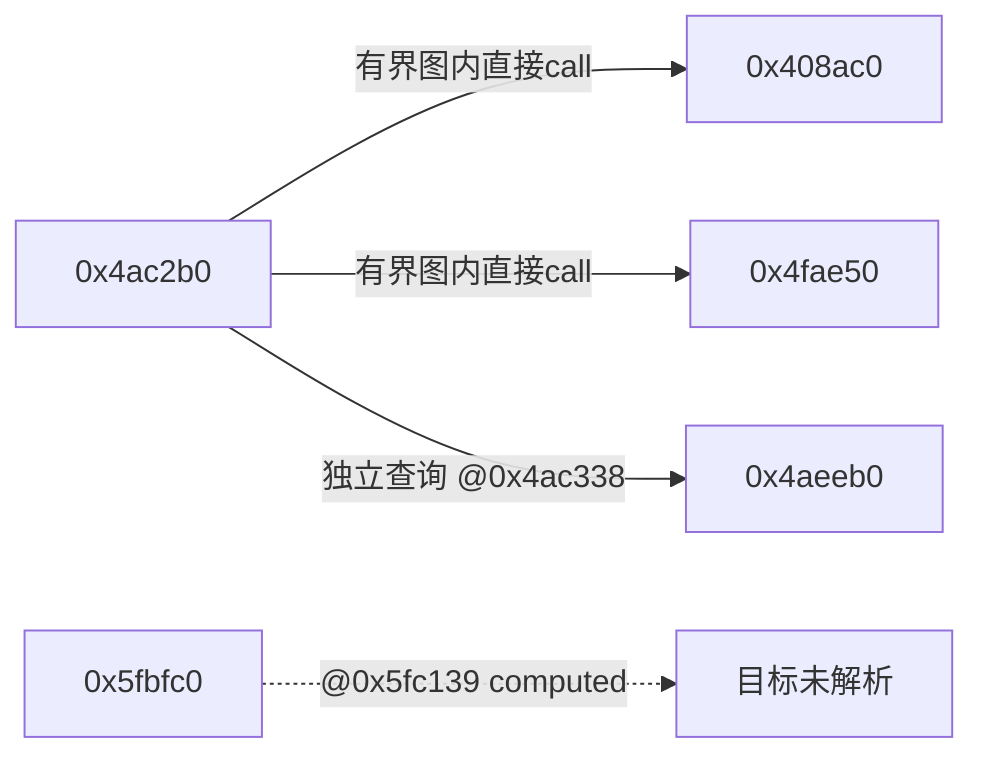
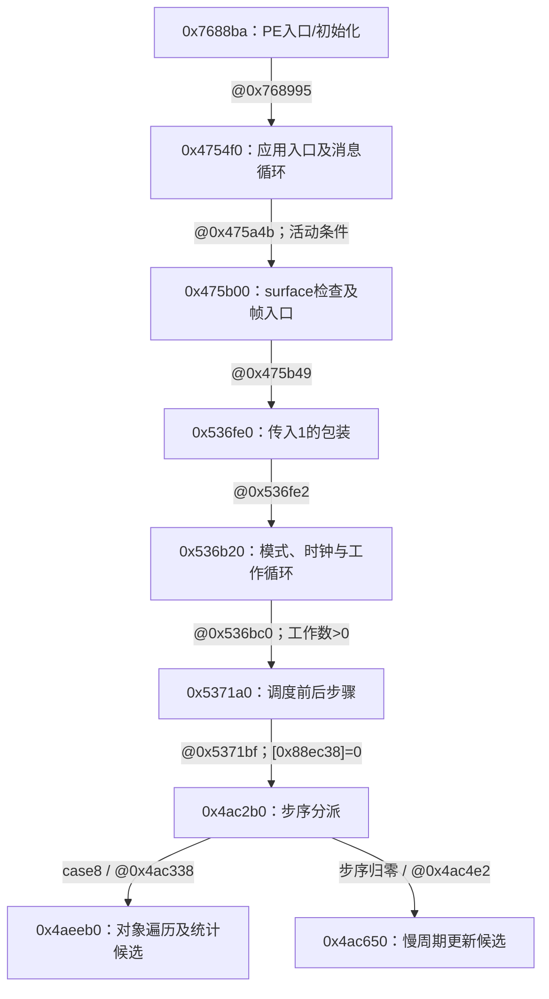

# REA 固定 PE 主静态路线与原版接线缺口

2026-10-11，扩链基线 `6a5c2475ada69d27f56bdd379703bde2e9236558`。固定原PE的入口已通过七条typed引用/解码CALL连到主循环、调度及phase8；累计30个唯一相关函数、8个关键站点，在共享20分钟预算内714.653秒完成并正常清理。新证据说明phase8的容器/对象/虚表槽、worker的引用释放路径，以及DirectDraw/Miles/Bink的原调用来源。虚表目标及完整原tick仍未知；目标SHA/身份未变，没有执行原程序。

最新 [phase8/worker ABI合同附录](REA_ABI_CONTRACTS.md) 补全索引布局、AsyncOp候选首槽的清栈/flags/返回和队列入引用路径，并修正worker上游零参数的分支条件。该轮新增20个函数、6个调用站点和3个上下文指令锚点，802.024秒；实际对象表、真实释放及完整tick仍未知。此前30函数/8站点/714.653秒是主路线轮次，未与ABI轮次混计。

## 安装来源与复现

本地工程：`/Users/zoomzhao/Workspace/emperor-native-media`。CLI 安装在 `.local/rea-cli-6.4.0/node_modules/rea-agents`，没有替换全局 Node/npm/REA，没有运行 `rea setup`、安装分析器或写入持久 MCP/技能配置。已有全局 REA 保留原状。

| 项目 | 固定来源或本次实际结果 |
|---|---|
| 官方源码 | [morluto/rea 固定提交](https://github.com/morluto/rea/tree/a56f7bb668ab23fec8d33f7af353ac7ed2fe1895)，gitHead `a56f7bb668ab23fec8d33f7af353ac7ed2fe1895` |
| npm 发布 | [rea-agents 6.4.0 元数据](https://registry.npmjs.org/rea-agents/6.4.0)；名称、版本、repository、dependencies、engines 与固定源码 package.json 一致。浮动 main 已有依赖差异，不能作为完全相同的发布凭据 |
| 发布 tarball | [官方 npm tarball](https://registry.npmjs.org/rea-agents/-/rea-agents-6.4.0.tgz)；SHA256 `59eb1604b8db75f522d4a975c36ce6b4a2ad465e43bad165f9a8f728391db9b8` |
| npm integrity | `sha512-Vj1zWfSlna5bphGoaoI/TcVBuYvze9u+OyPC3Shz8YkBqaCTqB4COnnRoX7XDwMpwI24ZlFEel2yEj0k8LTWEQ==`，下载内容与 registry 值一致；未验证发布签名/attestation，不把一致性核对称为签名认证 |
| 实际运行时 | Node `/Users/zoomzhao/.nvm/versions/node/v24.14.0/bin/node`，v24.14.0；配套 npm 11.9.0。默认 Homebrew Node v25.8.2 不满足该包 `^22.19.0 \|\| ^24.11.0 \|\| >=26.0.0` 要求，未改全局默认 |
| 安装锁文件 | `.local/rea-cli-6.4.0/package-lock.json`；SHA256 `53731622932f39150d6f01438ef247072207b57f63836adf66df2dd32ef0199f`；REA 版本/integrity 匹配固定发布，resolved 下载地址均属 registry.npmjs.org |
| 实际 CLI 入口 | `scripts/rea.mjs`；SHA256 `3554288a08c455fa419dad662d73710fb17debe94b9e71dd1282761117c5981e` |

实际安装使用上述 Node 执行同版本目录下 `lib/node_modules/npm/bin/npm-cli.js`，参数为 `install --prefix <隔离目录> --ignore-scripts --no-audit --no-fund --omit=dev --save-exact --registry=https://registry.npmjs.org/ --fetch-retries=0 --fetch-timeout=20000 rea-agents@6.4.0`。每次进程限时60秒；使用隔离 npmrc/global-npmrc/cache，子进程移除 npm token 和 NODE_OPTIONS，不读取或打印个人 npm 凭据，不改 HOME/CODEX_HOME。

已静态审阅发布包生命周期脚本：REA 无 preinstall/install/postinstall，prepare 在限定条件下可能初始化 Husky，prepack 用于打包。本次全部依赖生命周期脚本均禁用，没有执行 curl 管道安装器或更新/集成命令。有限遥测关键词扫描没有发现初始化代码，但不构成全依赖安全审计。REA 包含浏览器、网络、MCP 与运行观察能力，不能笼统承诺其所有功能都离线；本次对外只获取公开源码/npm 依赖和推送选定文档，没有上传原程序、GameData、资源或分析输出。

安装过程保留失败：首次下载/展开达到60秒限时；继续安装虽 exit0，但一个 MCP client 文件展开不完整，CLI 五项调用均启动失败。离线 `npm ci` 又因锁文件缺少其他平台的可选 PTY 条目而拒绝。随后将该次 node_modules/lock 保留为 `interrupted-node_modules`/`interrupted-package-lock.json`，从缓存与官方源重新安装；最终版本及以下实际调用均通过。没有启用安装脚本来解决问题，旧失败不会改写成通过。最终锁文件尚未再次用 `npm ci` 验证跨平台复现，PTY/调试/运行观察也没有验收。

## 第一阶段：无目标 REA 使用（已完成）

所有命令使用固定 Node 和本地 `scripts/rea.mjs`，临时环境设置 `REA_ANALYSIS_PROVIDER=ghidra`、`GHIDRA_INSTALL_DIR=/opt/homebrew/opt/ghidra/libexec`、`JAVA_HOME=/opt/homebrew/opt/openjdk@21/libexec/openjdk.jdk/Contents/Home`，未持久化。

| 实际命令 | 结果与可推断范围 |
|---|---|
| `--version`、`--help` | exit0；版本6.4.0，CLI 能加载。不是目标分析或原版运行证明 |
| `doctor --provider ghidra --json` | exit0，选定 scope `healthy=true`：Node、Ghidra路径/平台/架构/版本/headless/native decompiler/JDK 均通过。Ghidra 实际12.1.2，REA判为12.1.x兼容，官方已验证构建标为12.1.4；JDK实际21.0.12。没有运行目标分析或自动升级 |
| 同一次 doctor 的全环境结果 | `environment_healthy=false`；Hopper未发现、IDA未配置、REA技能/若干客户端注册未对齐。它们是未选择的集成诊断，不使已通过的 Ghidra scope 变成失败，也没有据此自动安装/注册 |
| `capabilities --json` | exit0，Ghidra availability为available；`open=false`、`analysis_run=null`、`analysis_activity.status=not_observed`，没有绑定或分析任何目标。列出的能力是提供者声明，不能当作已实测原目标支持 |
| `import-reference-source <冻结接口目录> --json` | exit0；`HistoricalSourceGraph`、authority=`historical-reference`、inventory_state=`partial`。九份授权自写 C/H 接口及三份既有审计的指纹与冻结来源逐项一致；relationships为空、parse_failures为空，不能推断没有C调用关系 |

导入仅包括 native_driver/runtime/platform_native/heap_connection、heap_native/thread_native 的自写接口及现有审计；没有遍历整个仓库或 GameData，没有复制原 domains/IR/目标字节。REA 此命令的关系解析只支持 JS/TS/JSX/TSX，C 在本次仅被识别和哈希。结果另保留 Node 路径竞争限制；provenance.importer_version 为 null，版本由独立 `--version` 记录绑定，不能擅改工具输出。图根 SHA256 为 `44fce8668b1e38f8d70398e548ac984adab6c61fefc2aed86ca3e65543a4a691`。

这些结果属于先前无目标阶段，不能拿其中 `target_open=false` 描述后来 inspect 的尝试，也不能把 doctor 健康当作目标分析已通过。后续新增证据如下；原调度/运行事实仍只引用既有报告。

## 第二阶段：固定 PE 的新证据（只读元数据）

本表只描述此前PE元数据阶段的证明能力；后续函数查询已补选定调用路径，见主静态路线与媒体站点表。

当前授权允许固定文件的纯静态检查，先前“本轮不读取EXE”仅是当时审计范围，已被这次明确授权替代；不将旧转换/执行路线的拒绝扩大为所有 PE 静态工作都禁止。

输入为 `/Users/zoomzhao/Workspace/lzjq/Exe/ghidra/input/EmperorEN.exe`，SHA256 `8a6d2df1015cb75d797546d117da5f82b86fd08726090c2a13d853b9009d6753`，4,820,992字节，路径/祖先无符号链接。每次 inspect 前后及只读元数据核对前后，文件哈希与身份未变。没有读取旧 Swift、GameData 或执行此文件。适用输入目录 AGENTS 已完整阅读；固定文件的新授权优先于通常先查既有 corpus 的指引。

| 新结果 | 证据级别与限制 |
|---|---|
| i386 PE32；image base `0x400000`；入口 RVA `0x3688ba`，VA `0x7688ba`，位于 `.text` | `PE_METADATA_ONLY`：自写只读 PE 头部/导入表解析器的结果，不是 REA/Ghidra 反汇编；没有入口指令、到调度的调用链或可达性结果 |
| `.text`、`.rdata`、`.data`、`.rsrc` 四节；15个导入DLL、433个导入项（包括ordinal项） | 仅声明的静态依赖；不是433个实际调用、所有运行时动态依赖或必要API的总表 |
| DDRAW.dll：`DirectDrawCreate` 一项 | 能确定导入工厂名字；工厂产生的接口、vtable槽位、对象生命周期、调用路径、色键/ROP/表面恢复仍未知 |
| mss32.dll：54个 Miles 导入 | 名字涉及 startup/shutdown、waveOutOpen、sample/stream/3D provider、状态/释放、速率/音量/声像/循环、文件与reverb/filter。不是54个已实现API；参数、callback、循环含义和实际触发未获证 |
| binkw32.dll：14个 Bink 导入 | 包括 `_BinkOpen@8`、`_BinkDoFrame@4`、`_BinkCopyToBuffer@28`、`_BinkWait@4`、`_BinkService@4`、`_BinkOpenMiles@4`、`_BinkSetSoundSystem@8` 等。修饰名仅是ABI线索，不证明结构布局、参数合同、音视频时钟或原播放通过 |
| KERNEL32/USER32/GDI32 等 | 声明有线程/事件/等待、内存/heap、加载器、异常及 `RtlUnwind` 等依赖；现有有限平台子集不能据此升级为完整Win32提供者 |

完整导入数量按DLL为：KERNEL32 152、USER32 115、GDI32 51、comdlg32 1、ADVAPI32 5、SHELL32 1、ole32 3、DDRAW 1、WINMM 1、WSOCK32 28、mss32 54、binkw32 14、ijl10 3、COMCTL32 1、WINSPOOL 3。ordinal项保持ordinal，不猜名字。完整元数据只保存在本地 `rea-static-gate-20261011/pe-metadata.json`；Git只发布此筛选结论，不上传原文件或原始分析输出。

入口 `0x7688ba` 与调度地址 `0x4ac2b0` 的静态连接已由后续扩链补齐，见新主路线；仍没有自然执行证据。

## 就绪失败、标准复审及最终静态关口

固定 Node/REA 使用以下相同命令，没有启动游戏、调用 SR/Unicorn/Wine 或使用替代执行器：

```text
node <本地 rea-agents/scripts/rea.mjs> inspect <上述固定 EmperorEN.exe> --provider ghidra --json
```

先前就绪尝试人为设45秒启动/60秒外层，全部失败保留如下。这是计算就绪预算，不是用户对静态REA任务的不可变安全限制。最终按官方支持的配置设300秒启动、整体600秒，没有改ownership/终止守卫、增加seed/extensions、忽略错误或执行目标；临时Program仍采用readOnly/deleteProject。

| 实际尝试 | 实际结果 |
|---|---|
| 普通沙盒，09:30:45 UTC | exit1，12.288秒；`execution_failure`、operation=`list_documents`、`GhidraLaunchError: Ghidra headless launch failed`、failure_kind=`start`、retryable=false。不是超时 |
| 标准 `require_escalated` 获准，09:32:08 UTC | 相同命令实际执行，exit1，12.131秒，同一启动错误；不是审批拒绝，也不是目标分析已通过 |
| 原先无目标自检的首次审批 | 固定 `diagnose_startup.mjs` 在 CreateProcess 前被拒，未执行；该拒绝凭据保留 |
| 同一无目标自检的一次标准复审 | 基于新用户授权与macOS分支不调用ps的源码证据，原命令/脚本指纹不变，标准 `require_escalated` 获准并实际执行；Java配置ok，helper准备失败并给出准确Swift/SDK冲突。脚本exit0仅说明保存诊断完成，不能称helper通过 |
| 配对已有SDK后的 `inspect final`，09:54:31 UTC | 子进程使用CLT Swift5.10/SDK14.5；exit1，47.053秒，`provider_timeout`、operation=`list_documents`、timeout_ms=45000。外层60秒未触发 |
| 同参数有自有日志记录的 `inspect observed`，09:57:50 UTC | exit1，47.790秒，同一45秒provider_timeout。自有ownership manifest的parent_pid匹配本次CLI；保留了PE导入和自动分析阶段日志；没有完成握手或查询结果 |
| 最终复用会话，10:14:36 UTC开始应用层open | 使用官方300000ms启动配置/600秒整体，外层exit0、174.761秒完成四项操作，官方session.close成功、自有临时根为空；各项结果与缺口见下表 |

最初两次失败记录的target hash均为上述SHA，provider_version=12.1.2，profile_digest=`e3402f2d7c487875edf3c6215fa95d67ee1fa133ba68c2390a9338b38656a7b2`。当时stdout只暴露包装错误；新的获准自检才取得明确SDK错误，不能改写旧日志。先前inspect及最终复用会话的输入前后哈希/身份均未变；自有临时根结束均空，没有报告cleanupIncomplete，不推断全系统残留进程为零。

自检的具体错误为：`this SDK is not supported by the compiler`。CLT编译器实际Apple Swift5.10，继承的SDKROOT指向MacOSX15.2.sdk，其Swift接口由6.0.3构建，报unknown attribute `_extern`及Swift模块构建失败。原包的helper编译使用同一继承环境；这一具体阻塞已经复现。随后只为本次CLI子进程设 `DEVELOPER_DIR=/Library/Developer/CommandLineTools`、`SDKROOT=/Library/Developer/CommandLineTools/SDKs/MacOSX14.5.sdk`，与已有Swift5.10接口配对；没有安装、更改xcode-select全局选择或编辑REA源码。后续运行越过launch error并到达Ghidra导入/分析，是该修正的实际证据。此前doctor健康不覆盖这个helper编译器/SDK组合。

观察日志记录Ghidra `Headless startup complete (1673 ms)`、`IMPORTING: Loaded 0 additional files`、`ANALYZING all memory and code`；同一目标临时副本已导入，没有加载额外程序文件。日志时间为宿主本地格式，原样保留，CLI status另记明确UTC。只在ownership manifest的parent_pid匹配本次Popen-owned CLI后记录该analyzer的ghidra.log/script.log/ownership；没有增加ps或任何替代查询，也没有读取其他analyzer日志。当时REA未在45秒内收到post-analysis握手，CLI返回provider_timeout；这些历史尝试不能记为已完成查询。后来官方300秒配置下默认自动分析就绪关口通过，查询实际返回，见最终结果。

原始审批拒绝理由保留如下（后来同一动作的标准复审已获准）：

> 该自检会调用 REA 的 ownership helper，而其实现包含 `ps` 进程表查询；这属于此前明确禁止重试的被拒绝 `/bin/ps` 路线，不能以间接 helper 方式绕过，即使不提供目标也不应执行。

原拒绝要求不得通过替代或间接执行绕过，也允许先核对授权/低风险证据。随后将新授权、固定macOS分支证据和同一精确命令交标准审批，仅复审一次并获准；不是换命令/执行器绕过。原拒绝与复审结果分别保留。历史“possible cybersecurity risk”的原转换/执行拒绝是另一组证据，不由这次自检复审扩大或解除。

只读源码补充核对发现：被拒脚本在 macOS 的 `prepare` 分支只编译 REA 自带 helper，Java LaunchSupport 通过普通 execFile 查询配置；该脚本并不调用 ps、执行 native reader 或启动 Ghidra。整个正常 ownership 生命周期另包含全系统 `ps -axo pid=,ppid=,pgid=,uid=,stat=,command=`，以及 native reader 的全系统内核身份快照和选定成员 token 检查。因此不得写成“自检已经读取进程表”或“前两次启动错误一定由ps导致”。这个区别提交了标准复审；获准后才执行同一无目标脚本，SHA256仍为 `659a5f2cc71d6d689bbd2925f8071148bb53c26cba3e0799aeea4309e9ca9e98`。

正常 lifecycle 的读取与清理范围：ps列出系统可见进程元数据，command可能含其他任务私密参数；macOS reader用KERN_PROC_ALL取身份快照，再对所选自有组成员读取KERN_PROCARGS2，仅输出runId/身份/失败原因，不输出其他环境值。清理可请求本次bridge退出，对本次根组/后代组的全部成员验证随机token并在发SIGKILL前复核；Ghidra不启用全系统token sweep，身份不可读/不匹配时停止清理。未改系统设置或权限。精确自检只涉及自有编译子进程的取消、临时/cache写入。随后获准的正常静态provider生命周期沿用原guard及查询、管理本次自有analyzer；没有用户其他进程终止。

用户已明确授权使用REA及“完全访问”。实际收到的环境仍标workspace-write/auto_review，没有工具或系统确认模式变更；没有声称已full access或修改模式。依当前允许的标准复审机制提交新证据后获准；用户话语本身不是放行证明，实际工具创建进程才确认这次获准。未重复向用户要求同一授权，未移除guard、伪造token、换ps/sysctl查询或执行器。

## 前次最小静态关口：官方超时配置与同一分析会话

固定REA6.4.0的 `dist/config/ghidraStartupTimeout.js` 明确默认330000ms；`REA_GHIDRA_STARTUP_TIMEOUT_MS` 接受正整数字符串，上限2147483647ms，由environment/parseConfig传至Ghidra client。先前45秒设置偏短，不能把它当不可变安全限制或要求用户重复授权普通计算时长调整。本次选择300000ms，整体最多600秒；分析取消点570秒，预留30秒给原有清理。没有无限等待。

CLI的每次DirectAnalysis命令都会关闭其独立session并删除临时项目。为避免四次重新导入，本次直接使用发布包内CLI/MCP共用的 `createBinarySession`、`EnhancedTools.execute`、`session.execute` 和官方Evidence构造/记录，再由未修改的 `withSessionCleanup → session.close` 退出。没有虚构CLI复用参数、注册MCP常驻服务或改变数据库就绪检查；复用限于这一次进程内会话，关闭后仍删除项目。官方参数/源码指纹与控制脚本见本地configuration-review.json。

实际顺序及范围：

```text
REA_ANALYSIS_PROVIDER=ghidra
REA_GHIDRA_STARTUP_TIMEOUT_MS=300000
createBinarySession → open(fixed PE, providerId=ghidra)
EnhancedTools.execute(binary_overview, {})
EnhancedTools.execute(trace_native_values,
  procedure=0x4ac2b0, max_depth=1, max_functions=4, max_call_sites=2,
  max_nodes=1000, max_edges=2000, offset=0, limit=1000)
session.execute(resolve_native_call_targets, address=0x4ac338)
session.execute(resolve_native_call_targets, address=0x5fc139)
official session.close
```

图内解析最多两站点，另仅查询两个指定站点；没有无限扩图。每项保存的JSON上限8MiB，实际最大为trace的587446字节。使用固定源码指纹和未编辑的官方所有权/终止/分析完成守卫；配置/runner的实际校验范围见后续可靠性说明，未提供全部源码成对前后哈希表。只为子进程配对已有CLT/SDK14.5；未安装或改全局配置/权限。

| 实际结果 | 新证据与准确边界 |
|---|---|
| inspect完成 | 默认自动分析及REA就绪关口通过；overview为REA derived workflow。分析数据库列6个segment（含Headers及loader的tdb）、26511个procedure、10187个defined-string项；这是静态库存，不能当原函数全部恢复、执行或游戏通过 |
| 深度1有界图 | 3次decompilation，函数为 `0x4ac2b0` depth0、`0x408ac0` 和 `0x4fae50` depth1。437个p-code/数据流节点、538条依赖边，不是437函数或538次调用。图内两条直接call依赖连接这两个depth1目标 |
| 图的截断及未知 | `truncated=true`；在 `0x4ac2c0` 遇到Call-site resolution budget reached，并报告两个子函数的parameter bindings unavailable/omitted。没有分页继续或扩大上限；ABI、alias、未遍历调用仍未知。该图是decompiler-derived静态依赖，不是原源码或运行观察 |
| 指定站点 `0x4ac338` | 位于procedure `0x4ac2b0`，status=direct、mechanism=direct，唯一返回目标 `0x4aeeb0`；依据Ghidra ReferenceManager的UNCONDITIONAL_CALL引用。这是新的独立静态引用，支持旧报告的CALL坐标，但不证明自然到达、返回栈、参数或完整tick |
| 指定站点 `0x5fc139` | 位于Ghidra识别的procedure `0x5fbfc0`；status=unresolved、mechanism=computed、targets=[]。不能推定目标不存在、永久NULL或对象类型；这个reference-only边界不识别vtable/closure等机制，receiver/工厂/注册/释放/callee ABI仍欠缺 |

最小静态连接如下。图内边和独立站点查询分别标出，箭头不表示执行次序：



所有新Evidence绑定原SHA `8a6d2df1015cb75d797546d117da5f82b86fd08726090c2a13d853b9009d6753`。两指定站点的Ghidra版本12.1.2、profile digest仍为 `e3402f2d7c487875edf3c6215fa95d67ee1fa133ba68c2390a9338b38656a7b2`；图的workflow profile另包裹该upstream profile，digest=`adf59a9eb8ea88027006d90d6432211004c64daf21b8a8b95306f2ef2a0d7521`。站点Evidence的confidence=observed指数据库静态引用观察；workflow confidence=derived，两者均不代表原游戏运行。

输入前后SHA及device/inode/mtime/size完全一致。整体外层174.761秒、exit0，没有触发300秒启动或600秒外层deadline；正常close成功、自有临时根为空。旧失败/拒绝日志不覆盖，新结果另存 `rea-static-session-20261011/`。原始Evidence、p-code图、分析日志及二进制只本地留存，Git只发布此筛选结论。

## 新完成：入口到调度的主静态路线

扩链基线为 `6a5c2475ada69d27f56bdd379703bde2e9236558`，仍只用同一SHA的原PE。上次官方close已删除临时项目，没有可续用的数据库；本次两进程各在一个会话内复用分析数据库，不声称跨进程缓存复用或独立cache-hit/sourceHash验证。查询累计30个唯一相关函数、8个关键站点；这些限制约束选择的函数查询，不限制Ghidra默认全映像自动分析。没有无界调用图导出。

首次会话377.320秒后，一项 `0x47f1b0` 的完整dossier因大量入引用触及单项8MiB上限，exit1并正常清理，已保存证据仍保留。随后使用官方procedure_pseudo_code/procedure_assembly/procedure_references的较小查询补齐该函数与余下依赖；未提高8MiB上限。两会话共用首次启动起20分钟的绝对截止时间与累计函数/站点/输出预算，最终从首次启动到最后close为714.653秒；第二会话exit0。两个自有临时根均空，输入前后身份/SHA一致，累计保存输出约43.3MB。一个函数在完整dossier超限后重查，不能把唯一函数数当调用次数或游戏测试数量。

七条连接同时有Ghidra typed call-reference及解码CALL支撑；箭头表示有条件的静态连接，不能证明已自然执行：



| 层级 | 静态证据及必须保留的条件 |
|---|---|
| 入口/初始化 | `0x7688ba`做Win32版本、命令行/StartupInfo等初始化，`0x768995`调用 `0x4754f0`。后者的文件/text、窗口/graphics、setup/audio检查有失败早退；不能把整个启动路径简化成无条件进入主循环。伪代码签名未可靠恢复所有参数，入口实参以保存汇编为准 |
| 消息循环 | `0x4754f0`的PeekMessage/GetMessage→TranslateMessage/DispatchMessage、Sleep/WaitMessage与退出检查已见。仅在 `[0x10de458]=0`、`[0x10de45c]≠0`且相应消息处理分支允许时调用帧入口；活动/退出字段含义不由地址名自动确立 |
| 帧/模式 | `0x475b00`检查两个surface对象的间接槽及失败恢复分支，退出字段满足特定值时早退，否则调用 `0x536fe0`。包装将1交给 `0x536b20`；模式字段 `[0x10de045]=0`走另一条路径，不进入此调度分支 |
| 工作量/时钟 | `0x536b20@0x536ba3`从 `0x53a130`取工作上限，正数才进入 `0x536bc0`。后者依赖timeGetTime、前次时钟 `[0x115f540]`、速度字段与 `[0x855214]`表、模式/其他抑制字段；静态返回0或10000不代表真实一帧执行10000次。循环还会按 `[0x10de3f4]`及消息条件把上限归零 |
| 主调度 | `0x5371a0`在 `[0x88ec38]=0`时调用 `0x4ac2b0`。后者typed jump-table在 `0x4ac2f3`分派，case8确切映射 `0x4ac338`；共享步序字段 `[0xc82ef8]`递增，下一值低于0x33时保留，否则归零并调用 `0x4ac650`。步序完整转一圈的自然输入/运行结果仍无证据 |
| 慢周期 | `0x4ac650`更新 `[0xc82ef4]`/`[0xc82ef0]`并分派大量依赖，子周期达到16时归零、`[0xc82eec]`递增并在超过11时归零。这些数值行为支持周期结构，尚不把字段直接命名为已证明的日/月/年或某一城市业务 |

## phase8与worker：已补的参数来源、仍未知的目标

`0x4aeeb0`先清理 `0xc82ffc`、`0xc82f6c`等输出缓冲及计数。`0x506240`返回静态容器 `0x10bc910`；`0x413a50(1)`是带边界检查的索引访问（不是无条件begin），与end helper `0x4f8200`形成从索引1开始的遍历边界；详细布局/异常合同见新ABI附录。记录的非零字节 `+0xc`及short ID `+8`筛选后，ECX=`0x8c7634`的索引池经 `0x47f1b0(ID)`给出对象槽，再解引用取得对象O；对象创建和具体类型未恢复。

对象byte `O+4`经 `0x426d10`筛选为1或3；之后出现三个未解析computed call：`0x4aef47`通过虚表 `+0xc8`，ECX=O、显式参数0x35；`0x4aef92`/`0x4aefaa`通过虚表 `+0x264`，ECX=O、参数来自 `0x5db530`递增筛选的类别索引（1..9，筛选谓词本轮未展开）。返回值用于局部求和与输出累积，另有 `O+0x48`非零、short `O+0x24>0`等门槛。两次 `+0x264`调用的保存汇编均从同一caller栈槽取类别；callee清栈/副作用未闭合，不能证明运行时参数值始终相同；伪代码的unaff_EBP不能当已证明的额外参数来源。这是城市对象统计/更新候选，具体业务与虚表目标仍未知，不能把地址/字段名称当业务证据。

历史称worker4的 `0x5fc139`现有更具体上下文：在 `0x5fbfc0`的等待/队列及引用释放路径中，队列上下文Q的 `+0x30`是当前对象槽。`0x6eb1c0`把队列节点payload（节点 `+8`）交给该槽，替换时对旧对象 `+4`递减引用，对新对象 `+4`递增；`0x6054e0`随后移除节点。尾部读取O=`[Q+0x30]`，InterlockedDecrement(O+4)非正时读取首word `[O]`，将O交给ECX、参数1入栈，在 `0x5fc139`调用该表的首项，然后清空当前槽。布局/条件与引用计数释放或删除析构函数相容，**这是当时的候选结论；新ABI附录已找到WONAPI::AsyncOp基类表及首槽删除包装器并核清该候选ABI，当前对象的派生类型/最终表与该候选仍未唯一绑定**；不能再只称为任意城市更新callback。

直接上游 `0x6124a0@0x6124f4`传ECX=外层对象+4；第一32位参数在外层byte `+0xa1=0`分支为0，在非零分支为ESI中的输入预算减已经过时间，第二32位参数来自EBP。外层通过 `+0x9c`对象的虚表槽 `+0x24`调用另一接口也只发生在 `+0xa1=0`分支。此前漏掉非零分支的“显式零”已按第二方核验和保存汇编更正。没有证明 `0x6124a0`与上述城市主路线或具体工作线程连通；其另一个入引用在 `0x612730`，提供者未给出所属函数，保留为边界缺口。

## 原graphics/audio/video的实际静态调用

| 路径与站点 | 本轮明确分类 | 参数/依赖来源与限制 |
|---|---|---|
| 应用入口→ `0x52b590`→ `0x52bde0`→ `0x52bc30@0x52bc45` | **direct**→ `0x5fb4c0`，FunctionManager标为DirectDrawCreate跳板，目标 `EXTERNAL:0x149`；IAT=`0x7a9020` | 三个显式参数为NULL、栈输出地址、NULL；该站点受 `[0x854c04]≠0`约束。`0x52bc30`还直接调用 `0x44d1d0`，后者 `0x44d307`另有跳板xref，但本轮未展开该函数/将该xref升级为独立typed调用点结果 |
| 应用入口→ `0x5c34f0`→ `0x761df0@0x761e4f` | **resolved-indirect/computed**→ `_AIL_startup@0`，IAT=`0x7a96b4` | 静态导入引用已解析；OS版本检查有早退，不能当真实Miles初始化已成功 |
| 同一 `0x761df0@0x761f50` | **resolved-indirect/computed**→ `_AIL_waveOutOpen@16`，IAT=`0x7a96b0` | 设备输出槽 `this+0x178`，format从 `this+0x17c`及配置字段组合、tag=1；本次保存汇编确认初始化receiver为0x1156bc8，失败/成功分支已见。`0x762ccb@0x762d40`另有open_stream的xref及typed出引用，随后设置loop/volume/start；不能当听觉或物理设备恢复验证 |
| 应用入口的有条件intro分支→ `0x41fed0@0x41ff8c` | **resolved-indirect/computed**→ `_BinkOpen@8`，IAT=`0x7a95cc` | 路径字符串/flags交给Bink，结果存对象 `+0x10`；没有读对应素材。BinkSetSoundSystem传BinkOpenMiles导入符号和 `DAT_01e56324`所指对象设备槽 `+0x178`，支持静态音视频依赖；该指针与初始化receiver `0x1156bc8`的身份尚未闭合，不能证明两路径实际共享同一已初始化设备 |
| `0x41fed0`→ `0x420ae0@0x420bac` | **resolved-indirect/computed**→ `_BinkDoFrame@4`，IAT=`0x7a95c8` | 从对象 `+0x10`取handle；同函数NextFrame、Service、Wait及消息泵有typed出引用，后调用复制路径；不能称解码/播放成功 |
| `0x420ae0`→ `0x41fdb0@0x41fea6` | **resolved-indirect/computed**→ `_BinkCopyToBuffer@28`，IAT=`0x7a95c0` | 目标地址/stride由surface descriptor及坐标组合；同函数间接surface槽 `+0x64/+0x6c/+0x80`和恢复重试分支已见。真实surface创建、接口版本、完整像素/裁剪合同及实际输出仍未验证 |

resolved-indirect是Ghidra对IAT外部符号的静态引用解析，与未知对象虚表目标不同，也不表示动态装载或调用实际发生。此表六个独立媒体站点，加phase8直连及worker站点，共8个关键站点；dossier保存的其他typed出引用不是额外独立站点查询或运行事件。

## 本轮可靠性与下一验证条件

两个日志均保存Invalid PNG data at `0x7cb3b8`，以及 `0x5786f0`/`0x4c7580`对未映射地址的反编译警告。默认自动分析完成不等于全映像反编译可靠。`0x5371dc`被Ghidra报告为terminal call，但解码汇编是尾跳转；不把此类元数据当普通调用/返回栈证明。上述入口链七条边另以解码CALL逐项核对。官方no-return修复修改的是临时数据库，原PE身份未变。

第二方对固定提交6a5c247的审核支持旧两站点及3-procedure截断图数量，同时指出未提供完整源码成对哈希表及独立缓存命中凭据。本轮据此收窄措辞：配置保存选定源码指纹，runner对选定ownership实现指纹做前后断言；不声称全部工具源码有独立前后测量表或cacheHash验证。旧图仍是437节点/538边，不能简称“三节点图”。新证据绑定同一subject SHA及Ghidra profile digest，保存文件内容SHA逐项匹配完成事件；这不认证所有反编译语义。

后续最有价值的三个收敛点：

1. **phase8具体对象/虚表目标**：追踪容器及 `0x8c7634`槽写入、对象构造时首word赋值，再解析表 `+0xc8/+0x264`。通过标准是同一对象来源→明确表→有效函数入口的静态链、参数/返回使用一致；仅有偏移/候选类名不能算通过。
2. **worker对象产生和释放ABI**：追踪队列节点 `+8`生产者、对象refcount/首word初始化、首槽真实目标及外层注册/线程入口。通过标准是入队→保留→出队→末次释放→具体callee的链与调用约定/所有权相互一致；参数1不能单独证明删除析构函数或实际free。
3. **启动/调度依赖及完成边界**：核对窗口回调/模式迁移、时钟/暂停字段写入、所有51个步序及慢周期依赖/退出边界。通过标准是条件和来源闭合、computed目标/未恢复函数/警告逐项明示。静态闭合与完整原tick运行通过分别记录；后者目前没有证据，旧被拦截的转换执行/动态对照路线不重启。

本地机器记录 `rea-static-route-20261011/verified-route.json`包含七条边的site/来源Evidence、六项媒体解析分类、对象/worker未知项、累计范围/时间、输入身份及全部保存输出的SHA。两个会话的raw dossier/伪代码/汇编/日志仅本地留存；Git发布筛选结论，不上传原二进制、素材或这些分析原文。

## 对当前原版接线的实际影响

| 环节 | 目前能据证说什么 | 仍缺什么 |
|---|---|---|
| 原入口到调度 | 新扩链确认入口→应用消息循环→帧/模式→调度的条件式直接连接 | 自然条件是否满足、原菜单/地图的全部消费者与实际执行仍未知 |
| 调度及phase8 | 新静态引用确认 `0x4ac338→0x4aeeb0`；tid1、返回 `0x4ac33d`、Watch7→8及真实栈仍仅属历史报告 | 静态CALL不是自然到达或完整tick。旧batch A预算失败、B/C未开始；本轮原执行仍0，无新合格活动输入 |
| 切片消费者及绑定 | 自写驱动导入memory/threads/heap/锁/API/目标表并检查入口/完成栈后调用入口，完成后诊断/清理/退出 | 当前 `_s82_entry`、`_s82_completion`、返回表/count和structural bindings仍未解析；App未链接原消费者、timer仍是自写CitySimulation；一次性驱动不证明连续原调度 |
| 动态callback | 历史 worker4 `0x5fc139`，ECX来自ESI对象、整数1、返回 `0x5fc13b`；初始槽为NULL | 初始NULL不是恒空；具体对象的工厂/最终表尚未闭合；新ABI附录找到AsyncOp基类表/删除包装器并核清该候选callee的ABI，但当前对象未唯一绑定。站点仍computed/unresolved，引用转移/真实释放/线程注册仍缺 |
| 平台及状态 | 当前有限15项dispatch，heap/TLS/LastError/线程ID、三种有限锁与memops；未知明确失败 | 旧选定集合20项Win32边界、20个非IAT目标、SEH/wait/wake/运行后冷恢复仍缺。新导入表扩大的是声明依赖视野，不证明这些接口已调用或通过 |
| graphics | 自造RGB555/565/BGRA的stride、裁剪、缩放、重叠及生命周期已有限定CPU/离屏Metal证据 | DirectDrawCreate跳板与原初始化已有静态连接，Bink复制进入surface槽；完整接口/像素消费者未验证。旧移位最大248/252与补位255不同，GPU读回不等于原画面或全游戏通过 |
| audio | 自造S16队列/循环、格式拒绝和fake设备恢复有离线证据，历史AudioUnit仅有限回调证据 | 54个Miles导入的合同/触发/混音/clock、真实输出与设备恢复未闭合；离线PCM不能当听觉验证，fake恢复不能当物理设备通过 |
| video | 自造MOV reader/PTS/seek/epoch/取消有局部证据；旧Bink仅无输入/无factory的失败证据 | 14个Bink导入与Miles音轨连接未实现/未验；自造MOV的最新集成仍 `writer start failed`，不证明原Bink播放、EOB或双缓冲通过 |

旧203函数/7346条静态指令/20089字节属选定构建证据，旧Stage82原函数调用为0。Stage73六函数、一个固定输入的有限匹配不能推广到203函数、原完整tick或游戏。更详细的提供者、API、heap及callback缺口见 [原版tick接线审计](ORIGINAL_TICK_WIRING_AUDIT.md)、[完整原版差距](ORIGINAL_GAME_GAP_AUDIT.md)；媒体验证范围见 [PLATFORM_AUDIT](PLATFORM_AUDIT.md)、[RGB555_BOUNDARIES](RGB555_BOUNDARIES.md)。

## 先前接口审计确定的独立工作（本轮未执行）

| 任务 | 具体通过标准 |
|---|---|
| 将新导入依赖落实到提供者/消费者合同 | 启动/完整tick/返回/线程/heap/callback及DDraw/Miles/Bink逐项标来源、版本/ABI、状态owner、实际消费者与缺符号；导入名、静态猜测、历史运行分别标证据级别；未知目标/ABI保持明确失败，不补空表或成功stub |
| 修正自写heap提交计划与可恢复状态格式 | fill+copy总预算/权限在提交前规划；失败不假称回滚。诊断与可导入快照分型并版本化，明确handles/regions/live及CPU/TLS/锁所有权；完全自造状态覆盖拒绝路径和重导入合同，只记适配器验证，不称原续跑等价 |
| 验收现有媒体消费者的可声明子集 | 用自造图片逐合同检查555/565舍入、padding/裁剪/缩放、旧句柄与迟到GPU完成；自造PCM/事件核对队列样本/游标/0循环语义、失效不消费、恢复续接及事件恰好一次；先修自造MOV writer失败，再核对seek/epoch/取消/EOF和资源上限。原Miles/Bink、听觉/物理设备、原画面分别留待专门证据 |

上述是先前接口审计列出的独立任务。本轮实际工作集中于REA对固定原PE的复审、环境诊断及已完成的有界静态查询，没有转去执行这些媒体/适配器测试。

窗口验收仍有独立的历史AX守卫失败：08:34:33两次助手在 `AXIsProcessTrusted()` 停止且未请求权限；08:29:45 `save panel required` 是另一个条件失败。本轮没有UI/键盘/音频设备操作或权限修改，也不通过REA UI功能绕过该守卫。

本次最小静态关口已经完成，45秒旧就绪预算不再构成阻塞。入口至调度的静态链已补齐；当前缺口是自然到达条件、phase8对象虚表及站点5fc139的具体释放目标/ABI等，不能把静态结果升级为完整原消费者接线或原行为通过。原二进制转换/恢复指令执行/原城市动态对照的旧拒绝路线没有重启；新工作仅纯静态REA，不执行原或派生游戏库。真正完整tick通过仍需自然合格输入、完整阶段/完成边界、来源/ABI一致且实际被调用的消费者/目标、有对应原状态/对象/有序写/事件证据、完整恢复和连续调度/受控退出；静态分析和安装本身不能证明这些行为。

## 可追溯凭据

本地任务根目录 `/Users/zoomzhao/Documents/Codex/2026-10-08/task-2`：

- `rea-binary-route-20261011/`：固定发布来源/integrity、失败/修复/最终安装锁、五项无目标调用、冻结接口manifest及结果摘要；原证据保持原样。
- `rea-static-gate-20261011/`：input identity、最初两次inspect失败、PE_METADATA_ONLY、ownership源码/精确拒绝及历史 `APPROVAL_SCOPE.zh-CN.md`；旧证据未覆盖。新增 `selfcheck-review-request.json`/`selfcheck-review-receipt.json`、`startup-selfcheck.json`/`startup-root-cause.json`、匹配SDK及观察runner指纹、`inspect-final.*`/`inspect-observed.*`及自有provider日志、`review-and-inspect-result.json`。后者记录当时状态：复审获准，SDK修正后仍45秒provider_timeout。
- `rea-static-review-20261011/`：前一次复审/SDK修正/45秒超时的历史结果与发布凭据。
- `rea-static-session-20261011/`：前次最小静态关口与发布凭据，包含3-procedure截断图及两站点。
- `rea-static-route-20261011/`、`rea-static-route-resume-20261011/`：本次扩链及小视图补齐，保存控制/范围/输入/完成事件、原始Evidence、自有日志及verified-route；这是入口至调度的静态主路线结果。原始分析只本地留存。
- `rea-static-abi-20261011/`：新的phase8/worker ABI有界查询、verified-abi、成对选定工具指纹、原始Evidence及提交/发布凭据；筛选附录见REA_ABI_CONTRACTS.md。

当前发布仅选择此文档和ABI合同附录。原EXE/依赖树/工具包/原始分析输出不入Git，GameData不读取/上传，既有工程草稿与授权接口来源指纹保持原字节。
